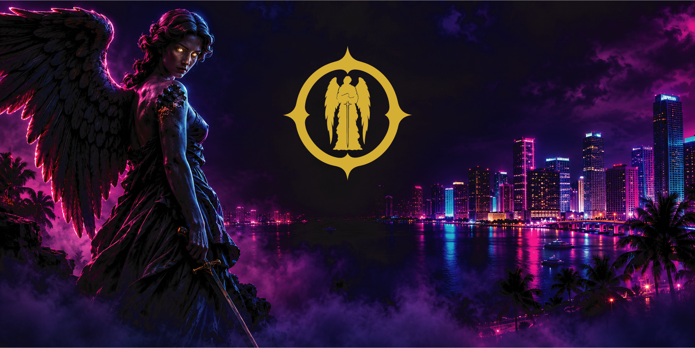

  <!-- ۱. بنر بالای صفحه -->
  
  
    

  <!-- ۲. جایگاه لوگو (اختیاری) -->
  <!--  -->
  
  <!-- ۳. نام برند (انگلیسی با فونت Cinzel و طلایی) -->
  <h1 style="font-family: 'Cinzel', serif; color: #d4af37; font-size: 40px; letter-spacing: 5px; margin-bottom: 0;">
    🏛️ ANGELFORT
  </h1>
  
  <!-- ۴. شعار (انگلیسی) -->
  <h3 style="font-family: 'Cinzel', serif; color: #888; font-style: italic; margin-top: 5px;">
    Where Law Meets Power
  </h3>
  <h4 style="color: #ccc; font-family: 'Vazirmatn', sans-serif;">
    جایی که قانون به قدرت می‌رسد
  </h4>
  
   
  
  <!-- ۵. نشان‌های وضعیت -->
  
  
  

 

---

### 🩸 The City is Yours to Take | شهر از آن توست
> *"In a city where the law is bought and sold, the only thing that matters is power. We don't play by the rules. We write them."*
> 
> *«در شهری که قانون خرید و فروش می‌شود، تنها چیزی که اهمیت دارد قدرت است. ما از قوانین بازی نمی‌کنیم، ما قوانین را می‌نویسیم.»*

**Angelfort** is not just another roleplay server. It is a living, breathing economic and political simulation built on the **MTA:SA Neon** engine. 
**آنگل‌فورت** تنها یک سرور نقش‌آفرینی (RP) دیگر نیست. این یک شبیه‌ساز زنده و نفس‌کش اقتصاد و سیاست است که بر پایه موتور **MTA:SA Neon** ساخته شده است. 

We are stripping away the easy money and infinite respawns to create a harsh, realistic world where every bullet, every dollar, and every decision matters.
ما پول‌های آسان و ریسپاون‌های بی‌نهایت را حذف کرده‌ایم تا دنیایی سخت و واقع‌گرایانه بسازیم که در آن هر گلوله، هر دلار و هر تصمیم اهمیت دارد.

Prepare to enter a city divided between the iron fist of the **Government** and the shadowy grip of the **Mafia**.
آماده شوید تا وارد شهری شوید که بین مشت آهنین **دولت** و چنگال سایه‌گون **مافیا** تقسیم شده است.

 

### ⚖️ The Factions | جناح‌ها
*   **The Government (Law) | دولت (قانون):** The President, the Police, and the Army. You enforce the law, or you bend it for a price.
    *   *رئیس‌جمهور، پلیس و ارتش. شما قانون را اجرا می‌کنید، یا آن را در ازای دریافت پول خم می‌کنید.*
*   **The Underworld (Power) | دنیای زیرزمینی (قدرت):** Two rival Mafia Families controlling the streets, the drugs, and the weapons.
    *   *دو خانواده مافیایی رقیب که خیابان‌ها، مواد مخدر و اسلحه‌ها را کنترل می‌کنند.*
*   **The Gangs | گنگ‌ها:** Start from the bottom. Build your crew, take territories, and fight for a spot among the top 20 gangs.
    *   *از پایین‌ترین سطح شروع کنید. گروه خود را بسازید، قلمروها را تصرف کنید و برای قرار گرفتن در بین ۲۰ گنگ برتر بجنگید.*

 

### 🚀 Development Roadmap | نقشه راه توسعه
We are currently in the early stages of development. The core UI and brand identity are complete.
ما در حال حاضر در مراحل اولیه توسعه هستیم. رابط کاربری اصلی و هویت برند تکمیل شده است.

- [x] Brand Identity & UI Prototype | هویت برند و نمونه اولیه رابط کاربری
- [ ] Core Server Architecture (Database & Factions) | معماری اصلی سرور (دیتابیس و جناح‌ها)
- [ ] Logistics & Cargo System | سیستم لجستیک و محموله‌ها
- [ ] Closed Alpha Testing (Invite Only) | تست آلفای بسته (فقط با دعوت)

 

### 🤝 Join the Empire | به امپراتوری بپیوندید
We are building a team. If you are a developer, a 3D artist, or simply a dedicated roleplayer, the gates are open for you.
ما در حال ساختن یک تیم هستیم. اگر شما توسعه‌دهنده، هنرمند سه‌بعدی یا حتی یک نقش‌آفرین متعهد هستید، درها به روی شما باز است.

  
  

 

---

  <i>© 2026 Angelfort Studios. All rights reserved. | تمامی حقوق محفوظ است.</i>

<!-- فونت‌های گوگل -->
<link rel="preconnect" href="https://fonts.googleapis.com">
<link rel="preconnect" href="https://fonts.gstatic.com" crossorigin>
<link href="https://fonts.googleapis.com/css2?family=Cinzel:wght@700&family=Vazirmatn:wght@300;400;700&display=swap" rel="stylesheet">
